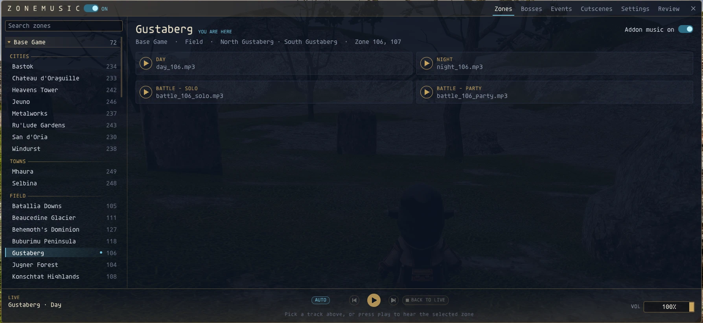
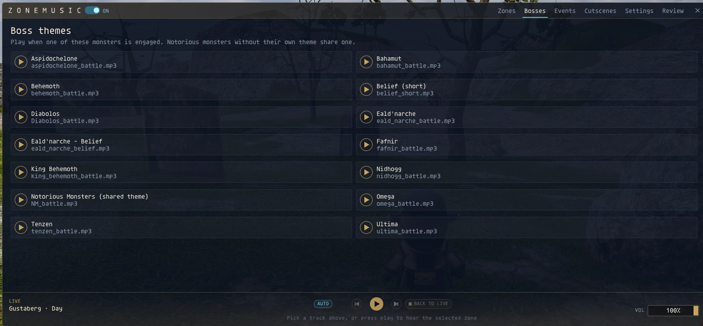
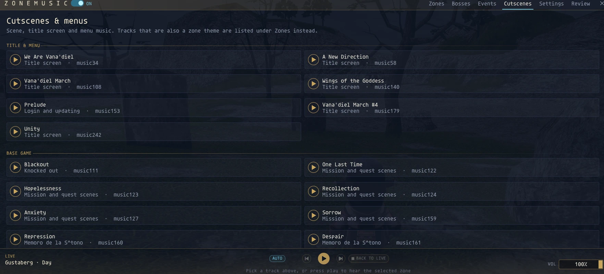

# ZoneMusic

Dynamic zone and battle music for Ashita v4. Version **2.0.2**.

## Download and install the addon

Download **ZoneMusic-2.0.2-addon.zip** from [GitHub Releases](https://github.com/OpMoonRise2/ZoneMusic-/releases/latest). GitHub is the addon download and source-review location. This installation ZIP contains code, documentation and the helper plugin, without music recordings or DAT overlays.

1. Unload the addon before updating. Preserve your existing character settings and audio library.
2. Extract the ZIP into your Ashita folder. It already has `addons/` and `plugins/` folders; do not extract it inside `addons/zonemusic/`.
3. Confirm `addons/zonemusic/` contains `zonemusic.lua`, `zm_ui.lua`, `zm_doctor.lua`, and `zm_shadow.lua`. The helper belongs at `plugins/ZMHelper.dll`.
4. Supply permitted MP3/WAV recordings in `addons/zonemusic/sounds/`, or install an optional audio pack below. The code ZIP alone provides no replacement recordings.
5. Load `/load ZMHelper`, then `/addon load zonemusic`. Open settings with `/zm`; use `/zm doctor` for installation checks. The helper improves native cutscene-music detection; see its [source and build instructions](helper/README.md).

Use the named addon ZIP for direct installation. The automatic GitHub source archives use the repository layout and are intended for source review.

## Optional audio and native sound overlays

The [optional ZoneMusic audio pack on Nexus Mods](https://www.nexusmods.com/finalfantasy11/mods/34) is separate from the addon. Download the addon itself from GitHub. You may instead supply your own audio using the filenames mapped in `zonemusic.lua`. Missing recordings cannot play.

Copy only the pack's `sounds/` content into `addons/zonemusic/sounds/`. Do not overwrite newer GitHub addon code with files from an older audio archive. Optional native sound DAT overlays are a separate component outside this GitHub release. If using a permitted overlay, place it under `polplugins/DATs/zonemusicDATS/` and add `zonemusicDATS` to your existing Pivot overlay list without removing other entries. No recording or DAT rights are granted by this repository.

## Screenshots

Screenshots supplied by the author for this publication; recordings shown are installed separately.

[Expansion browser](docs/screenshots/expansions.png) · [Track preview](docs/screenshots/preview.png) · [Status settings](docs/screenshots/status.png)

## How it works

ZoneMusic replaces the music you hear. It does not change anything the server sees, and it does not play the game for you.

- **Choosing a track.** The addon reads your zone, party and nearby entities from Ashita's memory manager (zone ID, engaged status, claim and boss names) to pick an idle, battle or boss theme. Then it plays an MP3/WAV from `sounds/` through the Windows MCI player (`winmm.dll`).
- **Keeping the native music quiet.** All of these are incoming, client-side changes that only affect what music you hear:
  - Incoming `0x00A` (zone-in): zeroes the five background-music slots in zones that have a cover track.
  - Incoming `0x05F` (music change): blocks the packet when the server resends a track that a cover already replaces (resident zone track, Mog House).
  - Injected incoming `0x05F`: silences or restores the game's own music slots when a cover starts or stops.
- **Handing music back for cutscenes.** It watches incoming `0x032`/`0x033`/`0x034` (event start), `0x052` (event release) and `0x00B` (zone-out) to pause its cover and let native cutscene music play. The optional ZMHelper plugin reports client-side cutscene scores that never arrive as packets. See [helper/README.md](helper/README.md).
- **Chat text.** It reads incoming chat lines only to recognise the Shadow Lord phase change and fishing.
- **Files.** It writes its settings, reads the ZMHelper signal file, and reads/writes `voice_duck_signal.txt` to lower music while BeastVoice or SCVoice speak. `dir /b` is used only to list audio files in `sounds/`.
- **Commands.** `/zm` and `/zonemusic` open the GUI and change settings; those handlers block only the addon's own slash commands.

It sends no outgoing packets, queues no game commands, creates no macros, and adds no targeting, distance or enemy information to the screen. Music and DAT sound overlays load through XIPivot.

## Tenzen boss music

Tenzen's boss theme requires his engaged mission encounter in Sealion's Den. The same-named trust in your party cannot trigger it. The author confirmed this correction in live testing; automated regressions cover the trust both inside and outside the mission zone.

## Shadow Lord music

`sounds/shadow_battle.mp3` plays during phase one; `sounds/shadow_battle_2.mp3` plays during phase two. `day_165.mp3` remains the room's idle theme. Solo and party engagement use the same boss override.

The phase-one defeat message arms the phase transition. A replacement or newly engaged boss after the entity gap selects phase two; Implosion provides a fallback when loading during phase two. Re-engaging alone does not advance the phase. The current theme holds through a brief entity gap (up to 20 seconds). Battlefield clear ends the encounter; zoning and logout reset it.

Covered native battle streams no longer interrupt engagement. Missing music IDs after an in-zone reload are recovered from stored settings, preserving fresh packet values. Once the intro ends, its native score cannot take ownership again outside actual event windows during that visit. Genuine later cutscenes retain their music. The lock resets on zone entry/departure or logout.

If phase two is missing, phase one continues. With both new tracks absent, existing battle selection remains available.

## Verification and maintenance

The author confirmed the final encounter behavior in live testing on 2026-10-18, including the teleport-exit fix. Automated regressions exercise selection, phase changes, native packet/helper handovers, reload recovery and intro replay. Run `python tests/test_shadow_music.py` with a Lua interpreter available (or set `LUA` to its path). These checks do not replace live testing of every zone or cutscene.

Character configuration, runtime signals, debug captures and backups are excluded from releases. The existing `ZMHelper.dll` is accompanied by source in [helper/](helper/README.md). Binary-to-source correspondence has not been independently verified; see [COMPLIANCE.md](COMPLIANCE.md). See [CHANGELOG.md](CHANGELOG.md) for release changes and [MAINTENANCE.md](MAINTENANCE.md) for project state.
